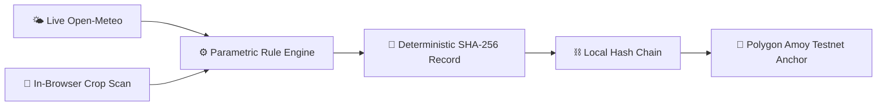

# 🌍 ClimaSphere AI

> **AI-Assisted Climate Risk Assessment with Cryptographically Verifiable Evidence**

[](https://climateledger.vercel.app/)
[](https://climateledger.vercel.app/)
[-8b5cf6?style=for-the-badge)](https://amoy.polygonscan.com/)

🔗 **Live Demo:** [https://climateledger.vercel.app/](https://climateledger.vercel.app/)  
📜 **Smart Contract (Polygon Amoy):** `<your Polygon Amoy address>`  
🎥 **Video Demo:** `<your video URL>`  

---

## 🎯 Problem Statement
Crop-loss claims, climate relief distributions, and carbon-linked parametric payouts depend on environmental evidence that is historically easy to manipulate and cumbersome to audit. Furthermore, ambient air pollution and crop damage are tracked in disjointed silos—even though elevated ground-level tropospheric ozone and relative humidity directly exacerbate foliage blight and fungal pathogens.

Traditional insurance cycles take **45 to 90 days**, require costly in-person damage assessments, and leave vulnerable smallholder farmers without timely liquidity.

---

## 💡 Solution Overview
**ClimaSphere AI** bridges physical farm conditions with cryptographic proof by joining real-time environmental telemetry, deterministic in-browser crop leaf segmentation, and an immutable evidence ledger into a single accessible web platform.



### 🌟 Core Workflow

1. **🌤️ Air & Weather Telemetry:** Live AQI, PM2.5, PM10, ozone ($O_3$), $NO_2$, $SO_2$, ambient temperature, and relative humidity ingested via Open-Meteo, featuring 24-hour PM2.5 peak tracking and stomatal clogging risk alerts.
2. **🍃 In-Browser Crop Leaf Scanner:** Client-side HSV (Hue, Saturation, Value) color-space segmentation measures visible discolored leaf tissue percentage. Features original, diagnostic overlay, and binary mask views. Raw farm imagery never leaves the user's device.
3. **⚙️ Parametric Loss & Trust Engine:** Evaluates multi-factor climate risk via explainable, deterministic threshold rules to compute a heuristic yield-loss percentage and an empirical consistency score.
4. **🔐 Tamper-Evident Ledger:** Assembles evaluation parameters into a canonical JSON payload, calculates a SHA-256 digest, and links it into a local hash chain. The evidence hash can be permanently anchored on Polygon Amoy via the `ClimateLedger.sol` smart contract.

---

## 🛡️ How Trust & Verification Work

A public blockchain proves a recorded hash has not been modified after inscription; it cannot verify whether raw ground inputs were truthful. To mitigate garbage-in/garbage-out risks:

* **Sanity Cross-Checking:** The engine cross-evaluates reported leaf damage against observed humidity and ozone metrics.
* **Empty Mask Rejection:** Image scans detecting insufficient green/leaf pixel ratios are flagged.
* **Data Traceability:** Offline test scenarios and illustrative fallbacks are explicitly tagged and disqualified from genuine payout eligibility.

---

## 📊 Parametric Payout Rule (`demo-rules-1.0`)

A simulated parametric claim is marked `ELIGIBLE` only when all three deterministic conditions pass:

1. **Foliage Discoloration:** Estimated visible damage $\ge 10.0\%$
2. **Environmental Stress:** Relative Humidity $\ge 70.0\%$ **OR** Ground Ozone $\ge 100\,\mu\text{g/m}^3$
3. **Assessment Consistency Score:** Data completeness and quality trust score $\ge 60 / 100$

$$\text{Trigger Condition} = (\text{Damage} \ge 10\%) \land (\text{Humidity} \ge 70\% \lor \text{Ozone} \ge 100\,\mu\text{g/m}^3) \land (\text{Trust} \ge 60)$$

> *Note: Out-of-range or missing metrics are classified as `NOT EVALUABLE` rather than passing by default.*

---

## 📜 Evidence Certificate & Verification (Schema 1.0)

Each assessment creates a unique, immutable Evidence ID (`CS-…`). The payload is deterministically serialized into a canonical array in fixed order to prevent key-drift across different runtimes:

* **Hashed Fields:** `sch, id, i, ts, city, crop, dis, lat, lon, aqi, pm25, o3, t, h, sev, loss, conf, elig, src, obs, rv, prev`
* **Excluded from Digest:** The canonical hash itself and mutable blockchain transaction states (avoids circular hashing).
* **Deterministic Verification:** Uploading a certificate reconstructs the canonical array, re-executes Web Crypto SHA-256, and compares digests. Any manual byte alteration produces an immediate `Integrity Verification Failed` notification.

---

## ⚡ Live Tamper Simulation Demo

Step 4 features a built-in **`Simulate Tamper`** auditor tool:

* Modifies an earlier block's recorded damage value in browser state.
* Highlights the compromised block in red and invalidates downstream block link hashes.
* Demonstrates how cryptographic chaining exposes fraud before smart contract validation.
* A **`Restore Original`** action returns the chain to its valid, self-healing state.

---

## 🛠️ Technology Stack

* **Frontend:** Vanilla HTML5, CSS3, JavaScript (ES6+), Tailwind CSS (CDN).
* **APIs & Telemetry:** Open-Meteo Air Quality & Weather Ensemble APIs.
* **Computer Vision:** Client-side Canvas API with HSV color-space pixel thresholding.
* **Cryptography:** W3C Web Crypto API (`crypto.subtle` SHA-256).
* **Smart Contract:** Solidity `^0.8.20` deployed on **Polygon Amoy Testnet (Chain ID: 80002)** via Ethers.js.
* **Testing Suite:** Node.js native test runner (`node --test`).
* **Deployment:** Vercel Edge Hosting (zero build step required).

---

## 📁 Repository Layout

```text
climasphere/
├── index.html                   # Production single-file web app (deployed on Vercel)
├── vercel.json                  # Security headers and static edge routing configuration
├── README.md                    # Project documentation and hackathon submission details
├── contracts/
│   └── ClimateLedger.sol        # Solidity contract storing evidence hashes on-chain
└── lib/                         # Reference tested TypeScript modules
    ├── certificate.ts           # Canonical JSON serialization & Web Crypto hashing
    ├── certificate.test.ts      # Unit tests for canonical certificate validation
    ├── riskEngine.ts            # Transparent, explainable parametric evaluation logic
    ├── hashChain.ts             # Sequential cryptographic block chain & audit logic
    └── engine.test.ts           # 17 unit tests verifying threshold & tamper behavior

```

---

## 🧪 Local Setup & Unit Testing

### 1. Run the Web Application

No build step or Node environment is required to run the frontend:

* Double-click `index.html` to open it locally in any modern browser, or
* Serve locally using:
```bash
npx serve .

```


### 2. Execute Reference Module Unit Tests

To run the automated cryptographic and risk engine test suites:

```bash
# Requires Node.js v22.6.0 or higher
node --test --experimental-strip-types lib/*.test.ts

```

*(All 17 tests validate canonical key ordering, SHA-256 determinism, boundary values, and block tamper detection).*

---

## 🌐 Localization & Regional Accessibility

* **Dual Language Support:** Instant English and Urdu toggling.
* **RTL Typography:** Urdu mode enables full Right-to-Left (RTL) container flipping with adjusted `line-height` scales to prevent Nastaliq ascender/descender collisions.

---

## ⚠️ Known Limitations & Scientific Disclaimers

1. **HSV Segmentation Scope:** Measures visible discolored pixel ratios. It does **not** replace microbiological laboratory assays or identify specific pathogen strains independently.
2. **Heuristic Formulas:** Dollar-per-acre and yield-loss figures are illustrative demonstration models requiring field calibration with local agricultural extension institutes.
3. **Treatment Notes:** Advisory notes are general agronomic references; farmers must confirm dosages with local certified agricultural extension officers.
4. **Local Chain vs. Blockchain:** The local hash chain is tamper-evident in the user's browser session. An immutable timestamp is established once anchored to Polygon Amoy Testnet.

---

## ⚖️ License

Developed for the **IEEE ClimateChain Global Hackathon 2026**. Distributed under the [MIT License](https://www.google.com/search?q=LICENSE).

```

```
