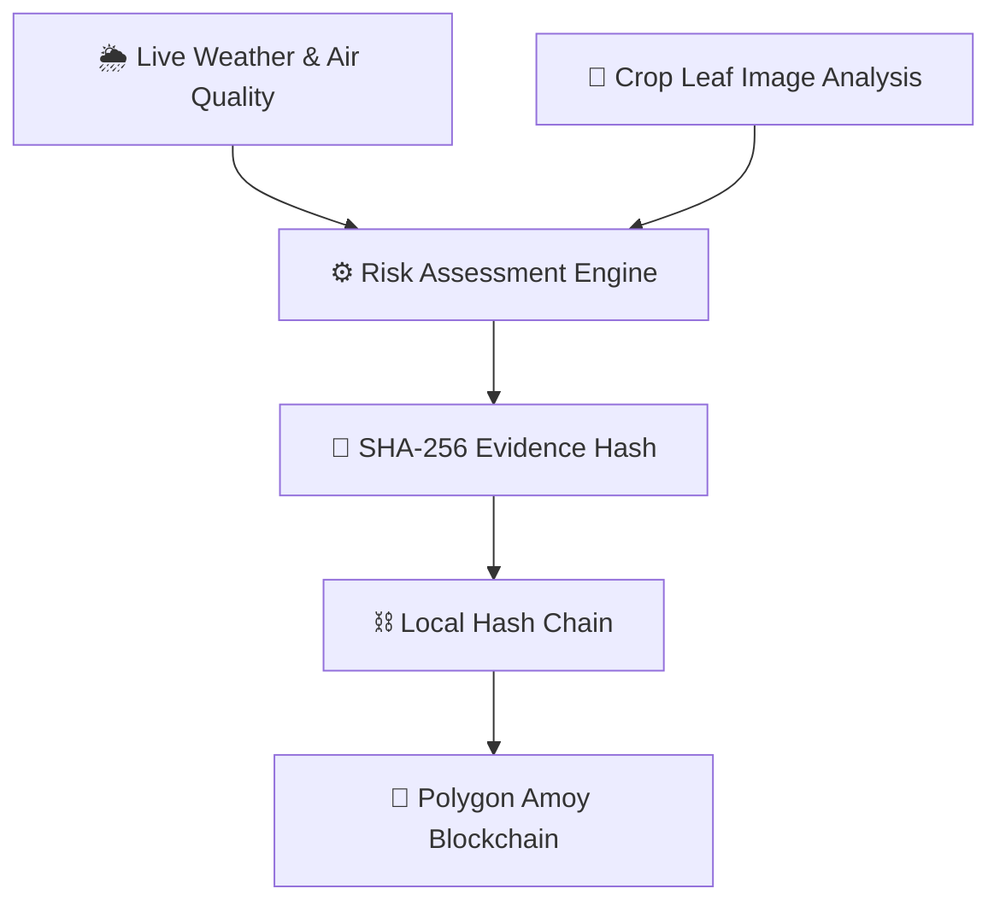

# 🌍🌱 ClimaSphere AI

### 🌦️ AI-Powered Climate Risk Assessment with Secure Digital Evidence 🔐

Welcome to **ClimaSphere AI**, a climate risk assessment platform that combines environmental data, AI-assisted crop damage analysis, and blockchain technology to help make agricultural damage assessments more transparent and easier to verify. 🌾🌎

Built for the **IEEE ClimateChain Global Hackathon 2026** 🏆

[](https://climateledger.vercel.app/)

[](https://climateledger.vercel.app/)

[](https://amoy.polygonscan.com/)

🔗 **Live Demo:** https://climateledger.vercel.app/

📜 **Smart Contract:** `YOUR_POLYGON_AMOY_CONTRACT_ADDRESS`

🎥 **Video Demo:** `YOUR_VIDEO_URL`

---

## 🎯 The Problem

🌾 Farmers can lose crops because of extreme weather, high humidity, air pollution, and plant diseases. However, proving crop damage and processing insurance or climate relief claims can be slow and expensive.

🚜 Traditional assessments may require in-person inspections and can take **45 to 90 days**, leaving farmers waiting for financial support.

🔍 Environmental data and crop damage records are often handled separately, making it harder to understand the full picture.

**ClimaSphere AI aims to make crop damage assessments faster, more transparent, and easier to verify.**

---

## 💡 Our Solution

🌍 **ClimaSphere AI** brings environmental monitoring, crop image analysis, risk assessment, and secure evidence records together in one web application.

It helps users:

- 🌦️ Monitor weather conditions and air pollution.
- 🍃 Upload crop leaf images and analyze visible discoloration.
- 🧠 Estimate potential crop damage using clear, rule-based calculations.
- 📊 Understand environmental risks through assessment results.
- 🔐 Generate tamper-evident digital evidence.
- ⛓️ Anchor evidence hashes to the Polygon Amoy testnet for blockchain verification.
- 🌐 Switch between English and Urdu for easier access.

### 🔄 How It Works



### 🌟 Key Features

#### 🌦️ 1. Live Weather & Air Quality Monitoring

Fetches environmental data through Open-Meteo APIs, including:

- 🌫️ Air Quality Index (AQI)
- 💨 PM2.5 and PM10 particulate matter
- 🧪 Ground-level ozone (O₃), nitrogen dioxide (NO₂), and sulfur dioxide (SO₂)
- 🌡️ Temperature
- 💧 Relative humidity
- 📈 24-hour PM2.5 peak tracking and related risk alerts

These measurements help provide environmental context for crop risk assessments.

#### 🍃 2. Crop Leaf Image Scanner

Users can upload a crop leaf image and analyze visible discoloration directly in their browser.

🔬 The scanner uses HSV color-space segmentation to identify pixels that may represent discolored leaf tissue.

🖼️ It provides three views:

- 📷 Original image
- 🔍 Diagnostic overlay
- ⚫⚪ Binary mask

🔒 **Privacy first:** Raw crop images are processed on the user's device and are not uploaded to a server by the image-scanning feature.

*Note: This is a visual analysis tool, not a laboratory test or a complete plant disease diagnosis system.*

#### ⚙️ 3. Climate Risk Assessment Engine

The risk engine evaluates environmental measurements and visible leaf damage using predefined rules.

📊 It produces:

- 🌱 Estimated visible leaf damage
- 🌾 A heuristic crop yield-loss estimate
- 🛡️ An assessment consistency and data-quality score
- ✅ A simulated claim eligibility result

The rules are designed to be transparent, so users can understand why an assessment passes or fails.

#### 🔐 4. Secure Digital Evidence

Each assessment receives a unique Evidence ID and a cryptographic SHA-256 hash.

🧩 The system:

- Creates a standardized evidence record.
- Calculates a SHA-256 hash from the assessment data.
- Links records through a local hash chain.
- Supports verification by recalculating and comparing hashes.
- Can anchor evidence hashes to the Polygon Amoy testnet using the `ClimateLedger.sol` smart contract.

⛓️ These features help reveal changes to recorded evidence.

---

## 🛡️ How Do We Build Trust?

Blockchain can help verify that a recorded hash has not changed, but it cannot prove that the original data was truthful.

ClimaSphere AI includes several checks to help identify unreliable inputs:

- 🔍 **Cross-checking:** Compares reported leaf damage with environmental conditions.
- 🍃 **Image validation:** Flags scans with too few pixels classified as green or leaf-like.
- 🧪 **Data quality checks:** Considers data completeness and consistency.
- 🏷️ **Demo data labels:** Identifies illustrative or offline fallback data so it is not treated as a genuine payout-eligible assessment.

These checks improve transparency, but they do not eliminate the possibility of incorrect or manipulated source data.

---

## 📊 Parametric Payout Rules

ClimaSphere AI includes a demonstration rule set called `demo-rules-1.0`.

A simulated claim is marked **ELIGIBLE** when all three conditions are met:

| 🌱 Condition | 📏 Requirement |
|---|---|
| 🍃 Visible leaf damage | At least 10% |
| 💧 Environmental stress | Relative humidity at least 70% OR ozone at least 100 µg/m³ |
| 🛡️ Assessment trust score | At least 60 out of 100 |

### 🧮 Rule Summary

```text
Claim is eligible when:

Damage >= 10%
AND
(Humidity >= 70% OR Ozone >= 100 µg/m³)
AND
Trust Score >= 60
```

⚠️ If required measurements are missing or outside the supported range, the result is marked `NOT EVALUABLE` instead of automatically passing.

📌 **Important:** These are demonstration thresholds, not validated agricultural insurance rules. Actual payouts would require field testing, expert review, and an appropriate insurance framework.

---

## 📜 Evidence Certificate & Verification

Every assessment generates a unique Evidence ID, such as `CS-...`.

🔐 The evidence record uses a fixed field order to ensure consistent hashing.

### What is included?

- 🆔 Evidence ID and schema version
- 🕒 Timestamp
- 📍 Location information
- 🌾 Crop and visible damage information
- 🌦️ Environmental measurements
- 📊 Risk and loss estimates
- 🛡️ Confidence or consistency information
- 🏷️ Data source and observation details
- ⛓️ Previous record hash

### 🔍 How Verification Works

1. 📄 The certificate data is reconstructed in a fixed order.
2. 🔐 The browser recalculates its SHA-256 hash.
3. 🧮 The calculated hash is compared with the stored hash.
4. ✅ Matching hashes indicate that the checked data matches the hashed record.
5. ❌ If the data has been changed, verification fails.

The hash itself and mutable blockchain transaction status fields are excluded from the certificate digest to avoid circular hashing and inconsistent results.

---

## ⚡ Live Tamper Simulation Demo

🕵️ ClimaSphere AI includes a **Simulate Tamper** feature to demonstrate how changes to recorded evidence can be detected.

### 🧪 Try the demonstration

1. ⛓️ Open the local evidence chain.
2. ✏️ Use the tamper simulation to modify an earlier block's damage value.
3. 🔴 Observe the compromised block and invalid downstream hash links.
4. 🔍 See how the chain exposes changes to the recorded data.
5. ♻️ Select **Restore Original** to return to the original demonstration state.

This feature shows why linking evidence records with cryptographic hashes can make unauthorized changes easier to detect.

---

## 🛠️ Technology Stack

| Technology | Purpose |
|---|---|
| 🌐 HTML5 | Web application structure |
| 🎨 CSS3 | Styling and responsive interface |
| ⚡ JavaScript ES6+ | Application logic |
| 💨 Tailwind CSS | UI styling utilities |
| 🌦️ Open-Meteo APIs | Weather and air quality data |
| 🍃 Canvas API | Browser-based crop image analysis |
| 🔬 HSV Segmentation | Visible leaf discoloration estimation |
| 🔐 Web Crypto API | SHA-256 hashing |
| 📜 Solidity `^0.8.20` | Smart contract |
| 💜 Polygon Amoy | Blockchain test network |
| 🔗 Ethers.js | Blockchain interaction |
| 🧪 Node.js Test Runner | Automated testing |
| 🚀 Vercel | Web application deployment |

---

## 📁 Project Structure

```text
climasphere/
│
├── index.html
│   └── 🌐 Main web application
│
├── vercel.json
│   └── 🔒 Security headers and routing
│
├── README.md
│   └── 📖 Project documentation
│
├── contracts/
│   └── ClimateLedger.sol
│       └── ⛓️ Smart contract for evidence hashes
│
└── lib/
    ├── certificate.ts
    │   └── 🔐 Certificate serialization and hashing
    │
    ├── certificate.test.ts
    │   └── 🧪 Certificate validation tests
    │
    ├── riskEngine.ts
    │   └── ⚙️ Risk assessment rules
    │
    ├── hashChain.ts
    │   └── ⛓️ Hash chain and audit logic
    │
    └── engine.test.ts
        └── ✅ Risk engine and tamper detection tests
```

---

## 🚀 Getting Started

### 💻 1. Run the Web Application

The frontend is a static HTML application and does not require a build step.

**Option A: Open directly**

1. 📥 Clone or download the repository.
2. 📂 Open the project folder.
3. 🌐 Double-click `index.html` to open it in a modern browser.

**Option B: Run a local server**

If Node.js is installed, run:

```bash
npx serve .
```

Then open the local URL shown in your terminal.

### 🧪 2. Run the Automated Tests

The reference TypeScript modules require Node.js v22.6.0 or later.

Run:

```bash
node --test --experimental-strip-types lib/*.test.ts
```

✅ The project includes **17 automated tests** covering areas such as:

- 🔐 Consistent certificate serialization
- 🧮 SHA-256 hash determinism
- 📊 Risk threshold boundary cases
- ⛓️ Hash chain integrity
- 🕵️ Tamper detection

---

## 🌐 Language & Accessibility

ClimaSphere AI supports both English and Urdu to make the platform more accessible.

- 🇬🇧 **English:** Standard left-to-right layout.
- 🇵🇰 **Urdu:** Right-to-left layout and adjusted typography.
- 🔄 **Language toggle:** Switch between languages directly in the application.

The Urdu interface includes layout and line-height adjustments to improve text readability.

---

## ⚠️ Limitations & Important Notes

Transparency matters, especially when technology is used for climate risk and agriculture. 🌍

1. 🍃 **Image analysis:** HSV segmentation estimates visible discoloration. It does not independently identify specific plant diseases or pathogens.
2. 🌾 **Yield-loss estimates:** The calculations are illustrative and require validation against real agricultural field data.
3. 💰 **Payout eligibility:** The rule engine demonstrates a possible parametric workflow. It does not authorize real insurance payments.
4. 🧑‍🌾 **Agricultural advice:** Treatment suggestions are general references. Farmers should consult qualified local agricultural experts before applying treatments.
5. ⛓️ **Local hash chain:** The browser-based chain provides tamper evidence within the local application state. Blockchain anchoring provides a separate on-chain record when a transaction is successfully submitted.
6. 🧾 **Blockchain limitations:** A blockchain hash can help verify recorded data, but it cannot independently establish the truth of the original measurements or image.
7. 🧪 **Testnet status:** Polygon Amoy is a test network. Transactions there do not represent production-mainnet records or guarantee real-world payouts.

---

## 🔮 Future Improvements

Potential next steps for ClimaSphere AI include:

- 🤖 Training and validating crop-specific disease detection models.
- 🌱 Testing risk thresholds with real agricultural field data.
- 🛰️ Integrating satellite imagery and additional environmental data sources.
- 📍 Supporting more crops and geographic regions.
- 🔐 Improving independent evidence verification.
- 🌐 Expanding accessibility for farmers in more languages.
- 🤝 Exploring integrations with agricultural organizations and insurance providers.

---

## 🏆 Hackathon Project

**ClimaSphere AI** was developed for the **IEEE ClimateChain Global Hackathon 2026**, focusing on climate data, environmental monitoring, transparent evidence, and blockchain-based verification.

🌍 Our goal is to explore how environmental data and secure digital records can support more transparent agricultural risk assessments.

🌱 **Better data. Clearer assessments. More trustworthy evidence.**

---

## ⚖️ License

This project is intended to be distributed under the [MIT License](https://opensource.org/license/mit).

📌 Make sure the repository contains the corresponding `LICENSE` file before describing the project as officially licensed under MIT.

